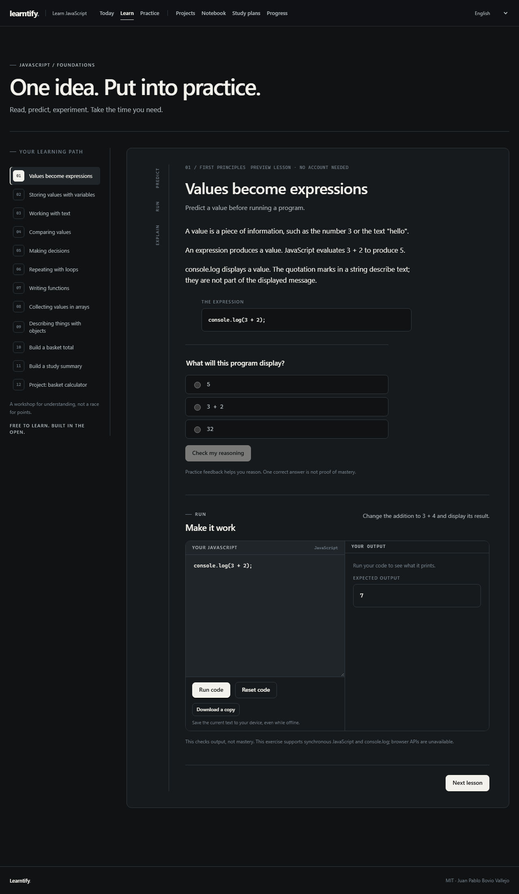

# Learntify

**Learn JavaScript from the ground up. Free, open source, in English and Spanish.**

Learntify brings explanations, predictions, executable exercises and guided projects into one learning workspace. Read an idea, try it in code, explain the result, and return to practice what needs attention.

[Explore the alpha](https://alpha.learntify.lat) · [Contribute](CONTRIBUTING.md) · [Report an issue](https://github.com/lilbovio/Learntify/issues) · [CI](https://github.com/lilbovio/Learntify/actions) · [MIT license](LICENSE)

## Inside Learntify

- **Learn by doing.** Bilingual foundations cover values, variables, strings, comparisons, decisions, loops, functions, arrays and objects.
- **Run real JavaScript.** An isolated browser runner provides output and exercise feedback.
- **Build and reflect.** Guided projects connect coding with explanations and interview-style reflection.
- **Keep your work.** Account features include synchronized drafts and notes, attempt history, progress, review practice and study plans.
- **Choose how to sign in.** Email links, passkeys, Google and GitHub are supported.
- **Use it your way.** A responsive monochrome interface includes keyboard navigation and reduced-motion support.



## Alpha status

The Cloudflare alpha offers public lessons and email-verified registration for adults 18 and older. First-time learners start with email, then can add a passkey or connect Google/GitHub. Registration can be temporarily limited when the shared email budget is exhausted. Private writes are paused during initial live-service checks, so account saving is temporarily unavailable on the hosted alpha.

Live authentication, recovery and learner rehearsals are still being verified. See the [release record](docs/ALPHA_RELEASE.md) and [acceptance checklist](docs/ALPHA_ACCEPTANCE.md) for evidence and outstanding checks.

Moderated discussions, study circles and expanded interview preparation are on the roadmap. The curriculum needs educational review. All learning features are intended to remain free.

## Run locally

Install **Node.js 24** and **pnpm 11.11.0**, then clone the repository.

```sh
git clone https://github.com/lilbovio/Learntify.git
cd Learntify
pnpm install --frozen-lockfile
pnpm dev:server
```

In a second terminal, run:

```sh
pnpm dev:client
```

Open [localhost:5173](http://127.0.0.1:5173). This public-learning profile runs locally without provider credentials.

For sign-in and saved work, use the [local account profile](docs/LOCAL_ACCOUNTS.md), which provides local D1 and a development mailbox on port 5174. To test real providers from your computer, follow [external local testing](docs/EXTERNAL_LOCAL_TESTING.md).

## Contribute

Help improve lessons, Spanish translations, accessibility, UI interactions, tests or documentation. Start with an existing [issue](https://github.com/lilbovio/Learntify/issues), or open one describing the problem and proposed change. Discuss larger architectural changes before implementation.

Read [CONTRIBUTING.md](CONTRIBUTING.md), create a focused branch, and open a pull request to `main`. Explain the behavior changed and how you tested it. Check both languages and phone layouts for learner-facing changes.

```sh
pnpm check
pnpm exec playwright install chromium
pnpm test:e2e
pnpm test:accounts
pnpm test:preview
```

`pnpm check` covers formatting, module boundaries, types, unit/integration tests and build dry runs. Browser suites start their local servers. On Linux, install browser dependencies with `pnpm exec playwright install --with-deps chromium`. The complete CI commands live in [the workflow](.github/workflows/ci.yml).

Keep credentials, private learner data and local databases out of commits.

## Project structure

Learntify uses TypeScript, React/Vite, a Hono Cloudflare Worker API, D1, Better Auth and Resend. Motion for React handles selected interface transitions.

- `apps/client` — interface, routes, translations and browser execution.
- `services/server` — HTTP routes, authentication, Worker entry points and migrations.
- `modules` — curriculum, learning and study-plan domain logic.
- `adapters` — persistence and email integrations.
- `packages` — shared API contracts and client.
- `tests` — public, account, production and preview browser journeys.
- `tooling` — architecture checks and local development utilities.
- `design/learntify-ui` — design specifications and reference boards.

See the [architecture](docs/planning/ARCHITECTURE.md), [module rules](docs/planning/MODULE_RULES.md), [API contracts](docs/planning/API_CONTRACTS.md) and [database model](docs/planning/DATABASE_SCHEMA.md). Planning documents describe intended direction; release evidence records what has shipped.

## Documentation

- **Learning features** — [code exercises](docs/CODE_EXERCISES.md), [guided projects](docs/GUIDED_PROJECTS.md), [practice and progress](docs/PRACTICE_PROGRESS.md).
- **Accounts** — [local accounts](docs/LOCAL_ACCOUNTS.md), [passkeys](docs/PASSKEYS.md), [local OAuth setup](docs/OAUTH_LOCAL_TESTING.md).
- **Hosting and operations** — [production configuration](docs/PRODUCTION_SETUP.md), [external services](docs/EXTERNAL_SERVICES.md), [operations and recovery](docs/OPERATIONS.md), [alpha invitations](docs/ALPHA_INVITATIONS.md).
- **Release process** — [deployment record](docs/ALPHA_RELEASE.md), [alpha scope](docs/ALPHA_SCOPE.md), [CI/CD plan](docs/RELEASE_PIPELINE.md).
- **UI and design** — [design handoff](design/learntify-ui/HANDOFF.md), [redesign coverage](docs/REDESIGN_COVERAGE.md), [Antigravity brief](docs/ANTIGRAVITY_UI_BRIEF.md), [OpenCode brief](docs/OPENCODE_UI_BRIEF.md).
- **Product direction** — [blueprint](LEARNTIFY_PLAN.md), [screen map](docs/planning/SCREEN_MAP.md), [backlog](docs/planning/BACKLOG.md).

## License

Created and maintained by **Juan Pablo Bovio Vallejo**. The software and original project materials use the [MIT license](LICENSE). Third-party materials retain their own licenses. Learner posts and private work retain their own terms.
