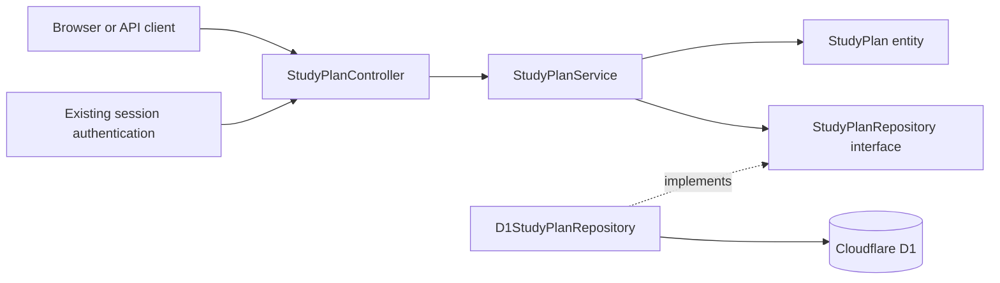
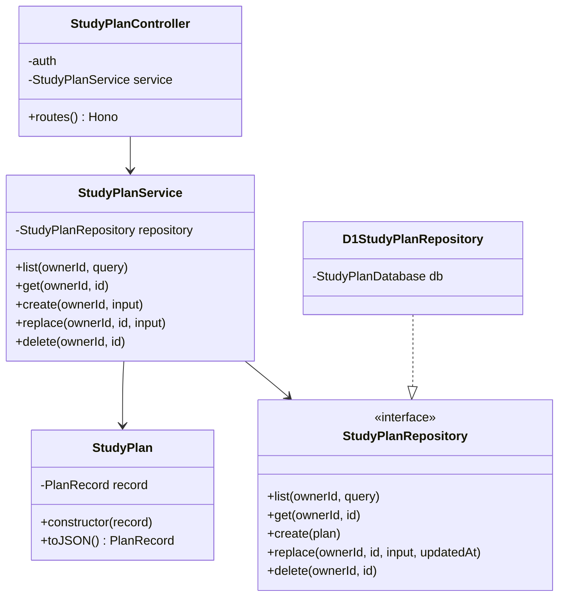
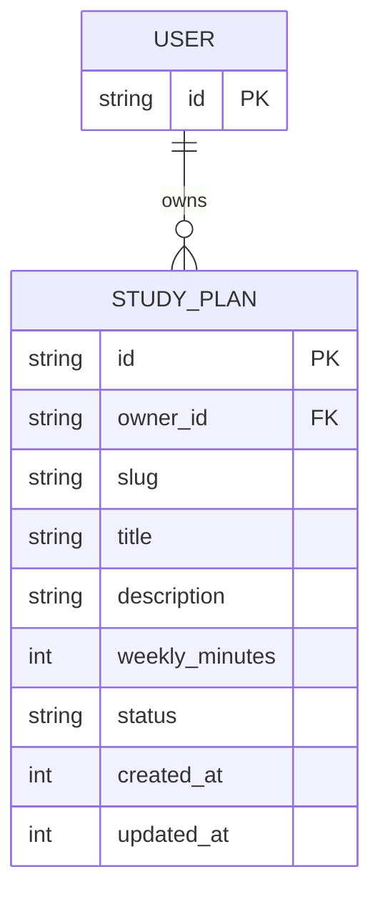
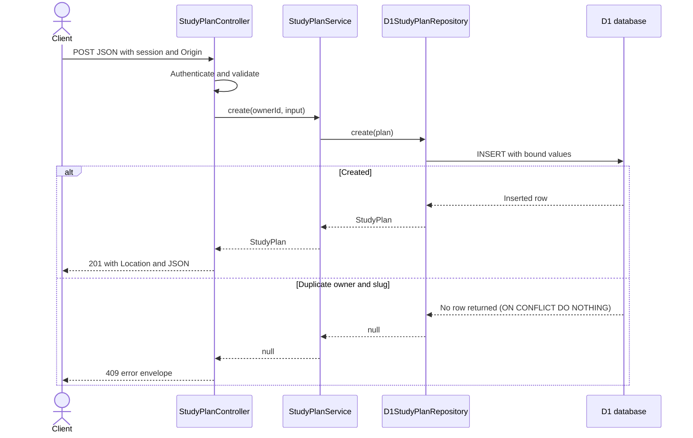

# Study Plans API diagrams

Implemented structure. See DEMO.md for the running application and validation commands.

## Architecture

## Class diagram

## Entity relationship

## Create request sequence

