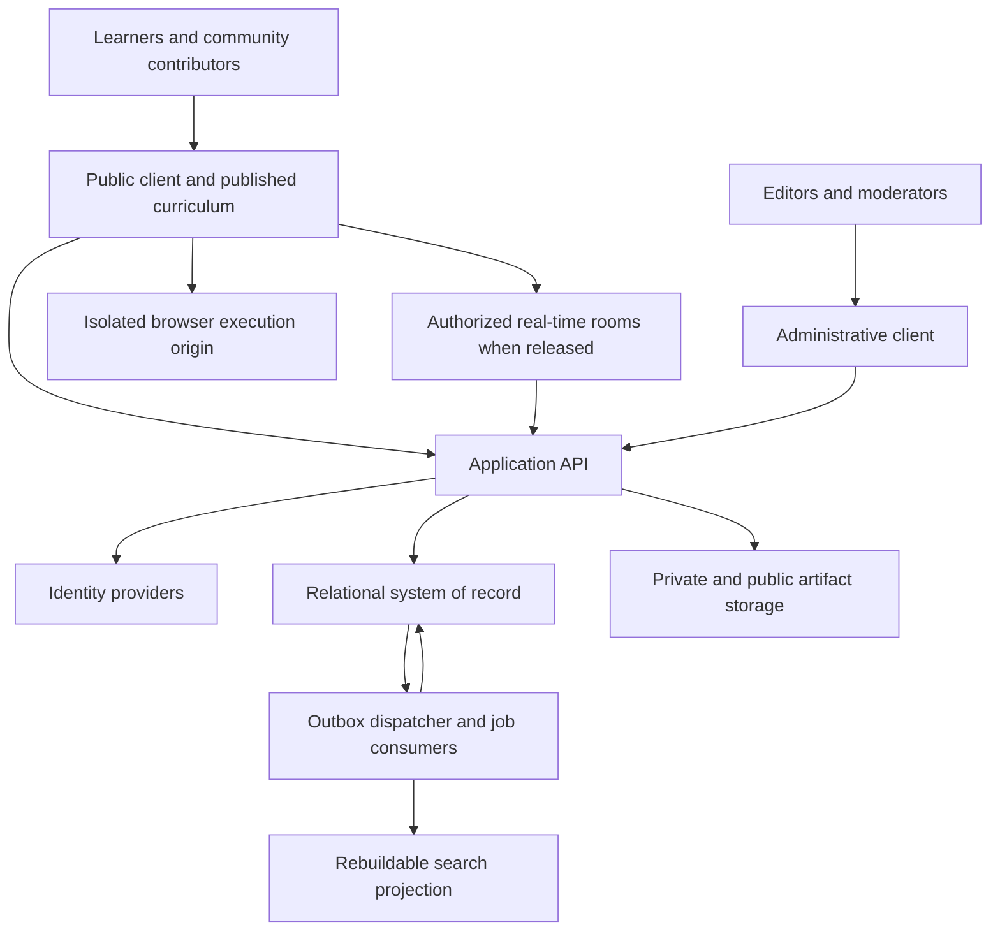

# Learntify architecture baseline

Planning only · October 21, 2026 · No implementation or deployment authorized by this document

## Decision status and precedence

TECHNICAL_DECISIONS.md now specifies the latest owner choices and recommended protocols: continuous draft sync, indefinite ordinary chat retention, admission limits, public-contribution deletion choices, and Better Auth/Resend as validation-gated candidates. Earlier references to bounded history mean bounded retrieval pages/capacity admission, not age-based message expiry.

Final owner clarification: MIT covers all owner-created project materials; email login is passwordless; learntify.lat is an intended future purchase; public posting and live chat remain unreleased until moderators join. Core learning may launch independently. DECISIONS.md contains the authoritative details and overrides older unresolved-question lists.

Owner answers are now recorded in DECISIONS.md and take precedence over earlier hypotheses here: strictly US$0 launch, one maintainer, adults-only accounts/community, Google/GitHub/email sign-in, live text chat in initial social scope, and best-effort availability. The 100,000-user model is a growth exercise. D1 is now the recommended starting candidate under this budget; high-growth database alternatives remain future evaluation paths. No moderators are committed yet.

Confirmed by the project owner: substantial public open-source product; MIT license; separate client and server; free access to every feature; voluntary donations; English and Spanish; Cloudflare-first preference. Architecture and code organization must be defined before building. Earlier suggestions to begin lessons/prototypes or scaffold services are superseded as immediate actions.

This document and CODE_STRUCTURE.md supersede architectural ambiguities in earlier planning files. DOMAIN_MODEL.md remains the logical entity reference; BACKLOG.md describes future implementation, gated by the architecture decisions here. Technology choices marked provisional require evidence later; they are not concealed commitments.

We can define responsibilities, invariants, contracts, and operational targets now. Throughput, accessibility, browser isolation, and recovery performance require future validation. No design document establishes production readiness by itself.

## Architectural approach

Recommendation: a modular application server with strict domain boundaries, independently deployed client and administrative client, asynchronous job processing, and separate real-time and execution boundaries when those capabilities ship. Keep related transactional workflows together. Deployments scale independently where workloads or trust boundaries require it.

A monorepo supports coordinated changes, contributor discovery, and shared contracts. It does not couple client and server releases. Avoid beginning with a service for every entity: that would require distributed consistency, version coordination, and operations before those divisions have evidence. Equally, avoid a single unstructured API folder with shared database access everywhere.

## System context and deployable units

- Public client: navigation, lessons, editor, local drafts, accessibility, i18n, and public community reading. Static delivery is the default; public lesson/forum indexing can use an explicit publishing/rendering path without making all routes server-rendered.
- Administrative client: content review/publishing, translation management, moderation, and operational views. Separate build/deployment; server authorization remains mandatory.
- Application API: sole entry for authoritative user actions and authorization. Owns request validation, use-case dispatch, bounded responses, and transactional changes through domain interfaces.
- Jobs runtime: retries, notification fanout, publication, exports/deletion, search projection updates, and scheduled maintenance. Shares domain application modules, not HTTP handlers.
- Real-time runtime: room connections, ephemeral presence, collaborative session coordination, and connection revocation. Introduced with live features, not an empty deployment now.
- Browser sandbox: distinct origin/trust boundary with no application secrets. Code is inert until explicitly run. Runtime output is untrusted input to the client.
- Future server assessment runner: separate hostile-code execution environment with job contracts and no direct access to application data. Hosting selection remains open; do not assume an ordinary API Worker can provide it.

## Domain ownership

Identity owns users, identities, sessions, role grants, and account lifecycle. Learning owns attempts, evidence, concept progress, review scheduling, and private notebooks. Curriculum owns versioned concepts, content, rubrics, and release manifests. Community owns public threads, answers, clinics, and subscriptions. Social owns connections, circles, membership, and teach-backs. Projects owns workspaces, snapshots, handoffs, and share grants. Interviews owns scenarios' session use, matching, sessions, feedback, and follow-up plans. Moderation owns reports, actions, appeals, and staff audit records. Notifications owns delivery preferences and read/delivery state.

Content scenario definitions and rubrics are published through Curriculum; Interviews owns learner sessions against those versions. Object bytes are a storage concern; Projects/Community/Learning retain ownership and visibility rules for their artifacts. A shared blob reference never implies shared permission.

Each domain exports narrow application operations and read contracts. A caller may request another domain's operation, but cannot import its repository or write its tables. A workflow spanning several domains has an explicit application coordinator; it does not hide cross-domain writes inside a utility.

Authorization is enforced at use-case entry and sensitive resource access. Shared authentication verifies identity; domain policy determines ownership, membership, visibility, or role rights. Realtime joins and every subsequent privileged operation recheck the appropriate authorization lifecycle.

## Data architecture and consistency

Use a relational system of record for accounts, social relationships, learning state, and workflow records. Preserve immutable version references and committed attempt evidence; use ordinary current-state tables for mutable workflows. Full event sourcing is not required. Projections such as search, recommendation caches, and aggregate counts are rebuildable.

In the initial single persistence boundary, attempt + evidence/progress + outbox commit atomically. If direct progress computation becomes too expensive, a later revision may commit the attempt/outbox and expose explicit pending progress until an idempotent consumer finishes. Never silently switch between those semantics.

Background delivery is at least once: stable event IDs, consumer deduplication, bounded retries with jitter, quarantine for repeatedly failing work, inspection/replay tools, and versioned event payloads. Notification failure does not roll back a saved answer. Events contain references rather than private code/feedback bodies.

Mutations use idempotency keys scoped to actor/use case, with request hashes and retained responses for a declared window. Concurrent edits use version preconditions; conflicting updates return a recoverable conflict. Timestamps are stored in UTC; user time zones determine scheduling display. Record server receipt separately from untrusted client times.

SQL migrations are owned by a single ordered migration history while one database is shared, with domain ownership in filenames/reviews. Use expand → migrate/backfill → verify → contract. Avoid destructive schema changes in the same release that stops using old fields. Backfills are resumable and bounded.

### Database decision: not settled by the free tier

D1 remains a bootstrap candidate, not a proven high-growth production decision. Its documentation describes each database as single-threaded; account/request/storage quotas also matter. Read replication, if selected later, does not solve write contention. [D1 limits](https://developers.cloudflare.com/d1/platform/limits/)

For the 100,000-user scenario, evaluate two explicit paths before implementation freezes persistence:

1. Cloudflare Workers + D1: operationally aligned with the preferred platform; accept only if realistic write mixes, transaction semantics, indexing/search, retention, and restore tests meet targets with headroom.
2. Cloudflare client/API + managed PostgreSQL: candidate for a relational workload with sustained concurrent writes and richer database requirements; requires provider, connectivity/pooling, regional latency, restore, and budget decisions. No provider or price is selected here.

Provisional recommendation for a launch genuinely targeting 100,000 active first-week users: budget for production infrastructure and compare PostgreSQL against D1 before choosing. Do not force a single D1 database or invent per-user sharding to preserve a zero-dollar target. Sharding would complicate social queries, moderation, uniqueness, and account deletion.

Storage interfaces protect domain code from SDK details; SQL dialect migrations still require real work. We do not promise a free database swap. A migration plan must preserve IDs, constraints, consent, and version history; use export/backfill, reconcile, controlled write cutover, and rollback criteria. Avoid indefinite dual writes without reconciliation.

## API and caching policy

Use versioned REST/JSON contracts with runtime validation and generated client types. Schemas expose API DTOs rather than database rows. Standardize pagination, errors, UTC timestamps, idempotency, trace IDs, and optimistic concurrency. Additive changes preserve independent client/server deployments; breaking changes need a supported transition window and deprecation plan. No GraphQL requirement is established.

Static curriculum releases and code assets are content-versioned and cacheable. Public forum content may use a short explicit cache lifetime with purge/revalidation on moderation; removed content must not remain indefinitely in search or cache. Personal state, private groups, sessions, and feedback never use shared public caching. Cache keys include relevant locale/version, not credentials.

Use server-side bounded search initially. Separate search indexing behind a port if multilingual relevance or query load exceeds the selected database's capability. Only index permitted public content initially; private search requires access-aware filtering and revocation handling. Search is eventually consistent and never authoritative for permissions.

## Capacity envelope: hypotheses, not forecasts

100,000 first-week users could mean visitors, accounts, or active learners. Planning uses 100,000 weekly active users as the main scenario and 100,000 daily active users as a surge scenario. These assumptions must be replaced by observed behavior.

- Main scenario: 25,000 daily active users × 2 sessions/day × 40 dynamic API calls/session = 2,000,000 dynamic calls/day; daily mean about 23 requests/second. A 10× peak factor implies about 232 requests/second. Test a rounded 250 requests/second sustained peak and a 750 requests/second short burst.
- Surge: 100,000 daily active users with the same behavior = 8,000,000 calls/day, about 93/second mean and 926/second at 10× peak. Test 1,000 requests/second sustained peak and a separate 3,000/second short burst as a later validation envelope.
- Main scenario concurrency: 50,000 sessions/day × 20 minutes ÷ 1,440 minutes ≈ 694 simultaneous sessions on average; a separate 5× concurrency factor gives roughly 3,500 peak sessions. This is not the same thing as request rate or open WebSockets.
- Main scenario learning volume: 25,000 learners × 15 attempts/day = 375,000 attempts/day. At an illustrative 2 KB metadata/attempt, about 750 MB/day before indexes, replication, revisions, and code blobs. This is a reason to model retention and separate payload storage, not an estimate of an actual record size.
- Realtime hypothesis: if 10% of peak concurrent sessions join rooms, approximately 350 simultaneous connections. Load-test 500 connections first, then 5,000 for surge planning; include room-size distribution and broadcast fanout.

The current 100,000/day Workers Free dynamic request allowance is below even the main scenario. Free-tier prototyping and a large launch are different operating budgets. Learners remain free in either case. [Workers limits](https://developers.cloudflare.com/workers/platform/limits/)

Validation workload must include login bursts, attempt writes, forum reads/replies, indexing, notification fanout, cold starts, large-but-allowed payloads, slow dependencies, bot traffic, retries, database growth, and hot rooms. Never report a cached-homepage benchmark as whole-system capacity. Request quotas, scanned rows, CPU, storage, and staff moderation capacity all matter.

## Reliability and recovery objectives

Future evaluation targets only, superseded as launch commitments by the owner's best-effort choice. Actual launch recovery capabilities must be documented after validation:

- Core API successful eligible requests: 99.9% over a rolling 30-day window. Exclude clearly invalid client requests; include server errors and capacity failures. Track authentication dependencies separately as well as their user impact.
- Representative API reads: p95 under 300 ms; durable writes: p95 under 600 ms, measured server-side and separately end-to-end from representative user regions. Exclude code-execution jobs from these request targets.
- In-app asynchronous notifications: 95% within 60 seconds, with visible degradation monitoring. Durable saves do not depend on notification success.
- Recovery: proposed durable-data RPO at most 15 minutes and RTO at most 4 hours. Provider capability, backup design, and restore drills must establish feasibility; these are not promises supported by today's empty deployment.
- Safety invariants: no acknowledged write lost in normal request retry paths, no duplicate evidence from retries, and no private data exposed by caches/search/notifications.

Monitor user flows, request error/latency, database saturation, outbox age, worker failures, quota usage, and cost. Use correlation IDs across requests/jobs without raw code, tokens, or private messages in logs. Alert on symptoms that need action; define an incident owner and bilingual status communication before launch.

Fallback order: disable costly optional uploads/live-room creation, preserve asynchronous features where persistence permits, retain cached lessons and local drafts, and explain pending synchronization. Auth/database outage must fail closed for private access. Do not claim offline support for unseen lessons or server-only actions.

## Security, release, and open-source trust boundaries

Treat learner code, Markdown, uploads, OAuth callbacks, and community content as untrusted. Use explicit origin policies, session/CSRF controls, object-level authorization, quotas, immutable artifact references, and scoped administrative privileges. Public repository access confers no production access. Never expose production secrets or private data to fork CI/preview deployments.

Separate development, staging, and production bindings, data, identity callbacks, and secrets. Deploy compatible server changes before client adoption where needed. Use feature controls for incomplete capabilities and gradual rollout; do not use them for paid access. Rollback code independently from forward-compatible migrations. A release needs meaningful integration, permission, contract, bilingual-content, accessibility, and recovery checks.

## Architecture decisions to resolve before building

Accepted constraints: MIT; separate client/server; no paywalls; bilingual; explicit domain boundaries; sandbox isolation; versioned content and evidence; monorepo recommended organization.

Proposed baseline: modular server, REST contracts, static-first client, atomic writes/outbox, room-scoped live coordination, infrastructure adapters, and defined service objectives.

Open decisions with consequences: production database and capacity budget; identity/recovery provider; intended age audience and moderation staffing; background queue/runtime and search implementation; final support targets; copyright holder/license coverage for content/assets; operational ownership. Each needs an ADR with context, options, decision, consequences, and validation criteria. Avoid claiming all of these are already validated.

Architecture planning is complete enough to review when those decisions have owners, all domain responsibilities map to APIs/storage, critical flows include failure behavior, capacity assumptions are agreed, and repository rules are enforceable. Implementation starts only when the user asks to move from planning to building.