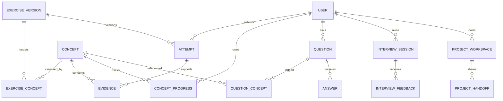

# Learntify domain model and service boundaries

Planning specification · October 21, 2026

## Shared model

Detailed physical design: DATABASE_SCHEMA.md; wire contracts: API_CONTRACTS.md; dependency policy: MODULE_RULES.md. These refine the conceptual model, including separate exercise/project draft tables, typed shared copies, room message/change cursors, and explicit Realtime ownership.

Technical extension: add private `Draft` records with owner, workspace/exercise version, revision, content hash and timestamps; idempotent save operation tracking; room-owned `ChatMessage` with client ID, sequence and moderation state; reconciled `AuthorRoomParticipation` for deletion lookup; and explicit `DeletionJob` contribution disposition. TECHNICAL_DECISIONS.md owns synchronization, indefinite message retention, and cross-store cleanup behavior. Drafts are distinct from immutable submitted attempts and explicit snapshots.

The central relationship is **concept → learning activity → attempt → evidence → recommendation**. Community and interview activities reference the same concepts, but participation and popularity do not automatically become learning evidence.

These are logical domains inside the independently deployed server initially, not a mandate for a microservice per domain. The client consumes versioned contracts and never accesses persistence directly. ARCHITECTURE.md now governs deployment and persistence decisions: D1 is a bootstrap candidate; the high-growth launch database choice remains gated on workload, transaction, recovery, and budget evaluation. Provider-specific references below are conditional, not a completed selection.

## Entities and ownership

### Identity and privacy

- `User`: stable ID, account status, created timestamp. Never use email or public handle as a primary key.
- `Identity`: user ID, provider, provider subject, verification metadata. Unique provider/subject pair; linking requires proof of control.
- `Session`: hashed opaque token, user ID, expiry, revocation metadata. Raw credentials never enter analytics.
- `Profile`: unique normalized handle, display name, locale, optional languages/goals, selected public fields.
- `Preference`: accessibility, notification categories, discovery opt-in, and optional time zone.
- `RoleAssignment`: scoped role and granting actor; platform roles and circle roles are separate.
- `Block`: blocker and blocked user, unique ordered pair; remove social eligibility in both directions.
- `ConsentRecord`: versioned record of specific sharing or recording permissions when needed. Sharing revocation cannot retract copies already downloaded by others; the UI must not imply otherwise.

Guest work begins locally with a client-generated identity and event IDs. Account import deduplicates events, preserves distinct attempts, and asks how to resolve competing project drafts rather than overwriting either.

### Curriculum

- `Concept`: stable language-independent key and lifecycle status.
- `ConceptPrerequisite`: directed concept edge; reject cycles and self-edges.
- `LearningPath` and `PathItem`: ordered concept/lesson references without duplicating their identity.
- `Lesson` and immutable `LessonVersion`: stable identity, concept objectives, published revision.
- `LocalizedLesson`: version, locale, explanation/hints/media text, review status. Unique version/locale.
- `Exercise` and immutable `ExerciseVersion`: format, prompt variants, evaluator definition, fixtures, hints, reference solution, and concepts assessed.
- `RubricVersion`: criteria, descriptors, applicable activity type, localized wording.
- `ContentRelease`: pins compatible lesson/exercise/rubric versions and both required locales.

Published content can be withdrawn from new sessions while historical attempts retain their version reference. Do not rewrite past results after correcting an exercise; mark affected results and offer reassessment where appropriate.

### Learning records

- `Attempt`: owner, exercise version, mode, submitted snapshot, outcome, hint/reveal context, client event ID, timestamps, evaluator provenance. Immutable after final submission except governed retention/redaction.
- `Evidence`: concept, learner, originating attempt or rubric observation, evidence type, independence level, provenance, validity status. Peer observations remain distinguishable from verified evaluations.
- `ConceptProgress`: derived learner/concept state, evidence references, policy version, last successful delayed retrieval.
- `ReviewItem`: learner, concept, due time, reason, status. Unique active scheduling rule prevents duplicate queues.
- `Recommendation`: learner, destination, explanation, policy version, expiry. A recommendation is guidance, not an authorization gate.
- `NotebookEntry`: owner, concept, mistaken assumption, corrected reasoning, optional snapshot, private visibility.
- `MisconceptionContribution`: separate approved-for-sharing copy, source consent, review status. It does not grant access to the private entry.

Keep progress derivation deterministic and reproducible. Idempotency prevents a retry from adding mastery evidence twice. Client-reported passes are labeled as client feedback; public certifications cannot rely on them.

### Community

- `Question`: author, title/body, language, visibility, moderation status, optional lesson/exercise version, optional approved snapshot, accepted answer ID.
- `QuestionConcept`: many-to-many concept tags for cross-language discovery.
- `Answer`: question, author, body, status; clarification `Reply` targets a question or answer with bounded nesting.
- `PostRevision`: prior content, actor, reason, timestamp, access-limited retention.
- `HelpfulMark`, `Bookmark`, `Subscription`: unique actor/target relationships. Helpful marks measure perceived usefulness, not mastery.
- `BugClinic`: associated question, expected/actual behavior, current snapshot, workflow status.
- `ExecutionTrace`: immutable snapshot/hash, runtime version, bounded trace payload, visibility inherited from the explicitly shared artifact.
- `TraceAnnotation`: trace ID and stable step ID, author, comment. New traces never reuse anchors ambiguously.
- `Report`, `ModerationAction`, `Appeal`, `AuditEvent`: separate reporting, disposition, and audit records; reports are not public thread content.

Accepted answer must belong to the same question and remain visible. Removing it clears or replaces its status explicitly. Content moderation status and question resolved status are separate fields.

### Social learning

- `ConnectionRequest`: requester, recipient, state; prevent self-requests and duplicate active pairs.
- `Connection`: canonical unordered user pair, created after acceptance, removed on either user's request or blocking.
- `StudyCircle`: owner, purpose, language, membership policy, visibility, lifecycle.
- `CircleMembership`: circle/user pair, role, invited/requested/active/left/removed state.
- `CircleGoal`, `CheckIn`, `CircleDiscussion`: shared goal and scoped participation. Circle discussions reuse rendering/moderation rules, not public visibility by default.
- `TeachBackSession`: concept, explainer, invited peer, explanation snapshot, follow-up, rubric version, status.
- `PeerFeedback`: author, recipient, activity reference, rubric version, observations, visibility; never a global expertise score.

Blocking invalidates pending pair invitations and prevents further direct interaction. Shared public spaces need explicit policy: suppress direct interaction and personalized discovery while acknowledging that public content is publicly readable. Private group removal and ownership transfer require separate actions.

### Projects

- `ProjectTemplateVersion`: requirements, concepts, starter files, tests, rubric, localized instructions.
- `ProjectWorkspace`: owner, template version, current revision, privacy.
- `CodeSnapshot`: immutable files/content hash, owner, provenance, size, retention, access scope.
- `ProjectPublication`: selected snapshot, public description, consent; no implicit access to private revision history.
- `ProjectHandoff`: sender, recipient, task contract, input snapshot, returned snapshot, status, scoped grant.
- `AccessGrant`: resource, principal, permitted actions, expiry, revocation. No broad ownership transfer merely because a handoff is accepted.

### Interviews

- `InterviewScenarioVersion`: format, concept links, prompt, role-specific guidance, fixtures if applicable, rubric version, localized content.
- `InterviewSession`: owner, scenario version, solo/peer mode, lifecycle, optional timer, artifact references.
- `InterviewParticipant`: session/user, role, invitation status, permitted views. Peer participants cannot read unrelated practice history.
- `AvailabilityWindow`: opted-in coarse availability and time-zone metadata; expose only proposed slots to strangers.
- `MatchProposal`: candidate/interviewer roles, topic/language, proposed UTC slot, both confirmations, expiry.
- `InterviewFeedback`: author/source, rubric observations, concept links, private recipient scope.
- `ConfidenceCheck`: self-reported confidence, recorded separately from rubric outcomes.
- `PracticePlanItem`: feedback-derived concept/action and optional review link; learner can accept or dismiss.

Behavioral sessions need no code attempt. Feedback and scenario prompts are versioned so sessions remain interpretable after content changes. Do not add a hireability field.

### Delivery and operations

- `Notification`: recipient, category, safe reference, dedupe key, read state. Authorize the target again when rendering content.
- `OutboxEvent`: committed domain event, schema version, retry state. Consumers are idempotent; no exactly-once claim.
- `ExportJob` and `DeletionJob`: requester, scope, status, expiry, failure reason.
- `DonationAcknowledgment` is optional and separate from authorization. No subscription, premium entitlement, or donation-based role exists.

## Key relationships

Diagram shows principal relationships, not every field or constraint; concept links for interview scenarios, projects, and teach-backs are also many-to-many where appropriate.

## State machines

- Content: draft → review → bilingual-approved → published → retired. A failed validation returns to draft/review.
- Connection: pending → accepted / declined / cancelled / expired. Accepted connections can be removed; blocking is enforced independently.
- Question resolution: open → resolved → reopened. Moderation separately allows visible / hidden / removed.
- Clinic: open → investigating → proposed repair → learner verified → resolved; reopen is allowed.
- Teach-back: draft → invited → active → feedback submitted → reflected → complete; cancelled/expired exits exist.
- Handoff: draft → offered → accepted → returned → reviewed → complete; declined/cancelled/expired exits preserve existing snapshots.
- Interview: draft → ready/scheduled → in progress → completed → reviewed. Cancelled, expired, or no-show are separate outcomes; resumption uses the same authorized session.
- Review: scheduled → due → attempted → rescheduled or completed. Due dates never remove prior achievements.

## API ownership and representative contracts

All routes below are proposed under `/api/v1`. Read collections use bounded cursor pagination. Mutations validate schemas, membership/ownership, request size, and idempotency as appropriate.

- Identity: `/auth/*`, `/me`, `/me/sessions`, `/me/export`, `/me/deletion`.
- Curriculum: `/concepts`, `/lessons/:id`, `/releases/:id`; author mutations require editor roles and version preconditions.
- Learning: `/attempts`, `/me/progress`, `/me/reviews`, `/me/notebook`. Attempt creation accepts an idempotency key and a pinned exercise version; the server derives owner from session.
- Community: `/questions`, `/questions/:id/answers`, `/questions/:id/accepted-answer`, `/reports`, `/clinics/:id/annotations`.
- Social: `/connections/requests`, `/circles/:id/memberships`, `/teach-backs`; accepted state cannot be supplied arbitrarily by the requester.
- Projects: `/projects/:id/snapshots`, `/projects/:id/handoffs`; every artifact read checks current access.
- Interviews: `/interview-scenarios`, `/interview-sessions`, `/interview-sessions/:id/feedback`, `/matches/:id/confirmation`.
- Notifications: `/me/notifications`, `/me/notification-preferences`; no client-chosen recipient for arbitrary notifications.

Use optimistic version checks for mutable drafts and edits. Stale updates return a conflict with recovery options. Specify stable error codes such as `AUTH_REQUIRED`, `FORBIDDEN`, `VERSION_CONFLICT`, `RATE_LIMITED`, and `TEMPORARILY_UNAVAILABLE`, with localized client explanations.

## Transactions, events, and storage

An attempt, derived evidence/progress update, and relevant outbox record should commit atomically within the same persistence boundary. Validate D1 batch/transaction constraints before choosing the implementation. Forum writes and notification scheduling follow the same pattern. If a later service split prevents atomic commits, define an explicit reconciliation policy before splitting.

Example events: `attempt.recorded`, `question.answered`, `connection.accepted`, `clinic.resolved`, `teach_back.completed`, `handoff.returned`, `interview.feedback_submitted`. Events contain stable references and minimal metadata, not raw private code or feedback bodies. A completed teach-back creates a review opportunity; it does not silently promote mastery.

The selected relational database owns durable account, forum, progress, and workflow records. R2 may own large immutable artifacts behind authorized access; public and private objects have separate delivery policies. Durable Objects can coordinate later live rooms/presence; durable learning records remain in the relational database. If live message history moves into room storage, define it as the single owner rather than maintaining two conflicting histories. Do not use eventual-consistency caches for authoritative sessions or permissions.

Index primary read patterns: learner/concept, learner/review due date, question/language/status/time, answer/question/time, circle/member, notification/recipient/time, session/participant, and author/idempotency key. Use an outbox for fanout rather than making one write per follower inside a request. Bound trace size, draft revisions, uploads, and search pages.

## Privacy and invariants to test

Lessons and public threads are public; attempts, notebook entries, unpublished projects, interview feedback, and private circles are not. Explicit sharing creates a narrowly scoped copy or grant. Staff roles confer only their required access; moderator inspection of reported private content must be scoped and audited.

Deletion policy must specify account identifiers, public contribution anonymization, private artifact deletion, backups, and shared-work attribution before launch. Avoid accidental cascading deletion of other learners' work. Public content exports cannot include hidden revisions or reporter identities.

Critical invariants: no unauthorized object access; no duplicate evidence on retry; no stale annotation anchors; no notification privacy leaks; no peer grading treated as authoritative mastery; no donation entitlement; both locales validated for published required content; no arbitrary learner code in the application API process.
