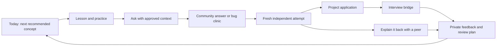

# Learntify screen map

Planning specification · October 21, 2026

Owner-decision update: initial social scope includes connections, asynchronous study circles, and live text rooms, subject to the pending moderation arrangement. Account/community eligibility is 18+. DECISIONS.md supersedes earlier screen release ordering. Add live-room access within S16 circle pages, with explicit join/leave, history, reconnect, report/block, and capacity-full states; collaborative editing remains later scope.

## Product structure

Release policy: public posting and live chat remain unavailable until moderators join. Hide unavailable community contribution/navigation entry points in a learning-only launch, and enforce availability server-side. Retain their screen specifications for the later social release. Email sign-in uses a one-time code/link; learntify.lat is planned, not yet an active deployment.

One learner identity, one concept graph, and one personal learning history connect Learn, Practice, Community, Projects, and Interview Studio. Each surface returns learners to a useful next action. A forum interaction never automatically becomes proof of mastery.

Desktop navigation: Today, Learn, Practice, Community, Projects, Interview Studio. Progress, notebook, connections, notifications, and settings live in the personal area. Mobile navigation exposes Today, Learn, Community, and More; the editor gets a focused workspace with a reliable back path. Only released areas appear in production navigation.

Routes below use `/{locale}` with `en` or `es`. Stable object IDs determine identity; translated titles do not. Changing interface language preserves drafts and session state. User-created content keeps its original language independently of the interface locale.

Visual system: claymorphism for navigation, concept objects, buttons, and milestones; quiet surfaces for long text and code. Warm ivory, charcoal, and terracotta are the starting palette, with restrained secondary accents. Keyboard focus, contrast, reduced motion, and a linear alternative to the concept map are mandatory. No purple-gradient identity or competitive problem-list homepage.

## The connected journey

The solo route works even when nobody is available to help. Community, pairing, and timed practice are optional enhancements, never prerequisites for accessing lessons.

## Public entry and identity

### S01 — Welcome · `/{locale}`

Explain the free learning promise, show a real sample lesson, and offer Start learning or Sign in. Secondary links: curriculum, community, accessibility, contribution, and voluntary support. Donations are never placed between a learner and a task.

### S02 — Sign in and recovery · `/{locale}/auth/*`

Provide supported authentication methods in plain language; preserve the intended destination and guest draft. Include provider failure, cancelled sign-in, expired session, account conflict, and recovery states. Identity-provider selection remains a technical decision from the auth spike. Never discard local progress after a failed login.

### S03 — Onboarding · `/{locale}/start`

Ask language, learning goal, and optional weekly availability. Default to beginner fundamentals; skip is allowed. Explain guest persistence and offer an account without blocking the first lesson. Social discovery is opt-in and independent from learning preferences.

## Learning and practice

### S04 — Today · `/{locale}/today`

Primary action: continue a lesson or recommended review, with a short reason. Supporting areas: current project, replies requiring attention, and a scheduled peer session if one exists. First-time users see the first lesson, not a dashboard full of zeros. Returning users with overdue practice get a manageable review choice, not a penalty.

### S05 — Learning map · `/{locale}/learn`

Browse stages and concepts with prerequisites and evidence states. Switch between a visual map and accessible outline. Explain why a concept is recommended; allow exploration ahead. Selecting a concept opens S06.

### S06 — Concept overview · `/{locale}/learn/concepts/:conceptId`

Show the goal, prerequisites, lessons, current evidence, related questions, project applications, and interview bridge. Primary action reflects the learner's state: Start, Continue, Practice again, or Review. Community and interview links share this concept identity.

### S07 — Lesson workspace · `/{locale}/learn/lessons/:lessonId`

Desktop: readable instruction alongside editor/output, with trace and hints as optional panels. Mobile: explicit Explain, Code, Output tabs preserving all state. Actions: predict, run, inspect, request hint, submit, save a mistake, or ask the community. Show content version and saving status without making implementation details dominate the lesson.

Ask the community opens a draft with a preview of shared code/context. Publishing requires an account and explicit confirmation of the visible content. Private notes and complete attempt history are never attached automatically. After submission, return to the exercise with its draft intact.

### S08 — Practice and review · `/{locale}/practice`

Separate recommended retrieval from optional topic practice. Show the concept, reason, and suggested session size. A session mixes task formats and ends with evidence plus a next step. Distinguish browser feedback from any future authoritative assessment.

### S09 — Personal progress · `/{locale}/me/progress`

Display independently demonstrated concepts, retained checks, reviews due, and project evidence. Explain each state and the relevant attempts. Keep completion and confidence distinct. No global rank or employment-readiness percentage.

### S10 — Mistake notebook · `/{locale}/me/notebook`

Entries contain the mistaken assumption, code snapshot if desired, corrected reasoning, linked concept, and a revisit action. Private by default. Public contribution creates a separate reviewed copy with an explicit preview; editing or sharing it never changes the original private entry silently.

## Community and connections

### S11 — Community home/search · `/{locale}/community`

Search questions and filter by language, concept, unanswered status, or followed topic. Show Ask a question prominently. Discovery favors relevance and unresolved questions rather than outrage or raw activity. Guests can read public content. No results offers a new question draft without losing the search context.

### S12 — Question composer · `/{locale}/community/new`

Title, goal, what happened, what was tried, language, tags, and optional snapshot. Preview Markdown and spoilers, suggest related questions, and clearly show public visibility. Save drafts locally or privately. Anonymous posting is not part of initial scope.

### S13 — Question and answers · `/{locale}/community/questions/:questionId`

Threaded answers with shallow clarification replies, helpful marks, accepted-answer status, edit markers, subscribe/bookmark, report/block, and links to concepts. Code runs only after an explicit sandbox action. “Try the fix” returns the asker to a fresh attempt; “This helped” records feedback but grants no mastery. Hidden or deleted content uses a clear tombstone where context must remain.

### S14 — Bug clinic · `/{locale}/community/clinics/:clinicId`

An opt-in question extension: reproducible example, expected/actual behavior, immutable trace, anchored annotations, revised code, and learner explanation. Helpers suggest investigations; the owner submits the repair. A changed snapshot creates a new version so annotations never drift to the wrong execution step.

### S15 — Profile and connections · `/{locale}/people/:handle`, `/{locale}/me/connections`

Public profile contains only chosen fields and selected projects. Request, accept, decline, remove, block, and report connections. Buddy discovery uses opted-in language, concepts, goals, and availability. Do not expose exact schedules, private progress, email, or interview feedback. No match offers solo work and asynchronous community help.

### S16 — Study circles · `/{locale}/community/circles`, `/{locale}/community/circles/:circleId`

Discovery lists deliberately public circles. A circle has a purpose, language, membership, goal, agenda, check-ins, discussion, and roles. Membership may be open, approval-based, or invitation-only. Membership and post visibility are explicit; private circle content is excluded from public search. Manage invitations, leave, report, and archive. Hosts moderate their circle within platform policy.

### S17 — Explain it back · `/{locale}/practice/teach-backs/:sessionId`

Select concept and partner, create an explanation with a code example or trace, receive a follow-up question, and revise. A concise rubric asks whether the explanation is correct, understandable, and transferable. Asynchronous by default. No peer response offers self-review; it never fabricates peer feedback.

### S18 — Notifications · `/{locale}/me/notifications`

Replies, accepted connections, circle invitations, handoff updates, and interview reminders. Support per-category preferences, mark-read, and quiet hours for future push/email channels. Initial delivery is in-app. Recheck access before revealing private context; a removed membership makes old links inaccessible.

## Projects and interviews

### S19 — Project library/workspace · `/{locale}/projects`, `/{locale}/projects/:projectId`

Projects connect requirements to concepts. Workspace contains instructions, files, tests, snapshots, reflection, and share settings. Work is private until deliberately published. A published showcase exposes a selected snapshot rather than the entire edit history.

### S20 — Project handoff · `/{locale}/projects/:projectId/handoffs/:handoffId`

Describe a bounded task, interface contract, inputs/outputs, tests, documentation, and a proposed receiver. The receiver accepts, reviews a snapshot, and returns feedback or a changed snapshot. Both retain attribution; accepting a handoff grants only the scoped access shown. Initial handoffs avoid concurrent editing.

### S21 — Interview Studio · `/{locale}/interviews`

Choose technical reasoning, practical coding, debugging, code review, project walkthrough, or behavioral practice. Show relevant concept bridges and prerequisite suggestions without mandatory locks. Offer solo, asynchronous review, or peer practice as those modes ship.

### S22 — Interview session · `/{locale}/interviews/sessions/:sessionId`

Workspace stages: clarify → plan → implement/discuss → test → reflect. Timers are optional. Solo sessions provide prompts and a self-review rubric; peer sessions give the interviewer a guide and candidate-appropriate view. Behavioral sessions use prompts and notes rather than an unnecessary editor. End, cancel, reconnect, and resume are explicit actions.

### S23 — Interview review · `/{locale}/interviews/sessions/:sessionId/review`

Separate self-reflection, peer feedback, test outcomes, and confidence. Each feedback item may link a concept and suggest a lesson, exercise, or project. Private by default. Mark feedback as self or peer supplied. Show no employment prediction.

### S24 — Peer matching/scheduling · `/{locale}/interviews/partners`

Opt-in matching by language, topic, role preference, and availability. Show a proposed time in each person's time zone before both accept. Include decline, cancellation, no-show, blocking, and solo fallback. Matching never guarantees a volunteer partner.

## Settings and operations

### S25 — Settings/support · `/{locale}/settings/*`, `/{locale}/support`

Language, appearance, accessibility, privacy, social discovery, notification preferences, linked identities, sessions, export, and deletion. Voluntary donation information lives separately and promises no privileges. Export/deletion show truthful queued/completed/error states.

### S26 — Content studio · author application

Concept graph, content versions, bilingual editor/preview, exercise/reference-solution validation, translation status, review and publishing. Editors cannot publish an incomplete required locale. Publishing reports dependency or test failures clearly.

### S27 — Moderation console · restricted application area

Reports, context preview, user history scoped to moderation needs, actions with reasons, appeals, and audit trail. Distinguish platform moderation from circle-host controls. Moderator access is not universal access to private learner notes or interview content.

## Cross-screen behavior and release checks

- Authentication loss preserves work and requests reauthentication before server writes.
- Offline or quota failure shows local/pending status; never claim synchronization that did not occur.
- Loading, empty, error, forbidden, deleted, and stale-version states are specified per relevant flow.
- Block checks apply to discovery, invitations, messages, notifications, and live participation. Explain that blocking cannot stop someone viewing anonymous public pages.
- Search and notifications never leak private content through snippets, counts, or cached responses.
- Every core flow is usable with keyboard, screen reader, reduced motion, and either interface language.
- Return destinations are allowlisted internal routes; deep links never bypass authorization.

First release connects S01–S09, S11–S13, S18, a bounded S19 project, solo S21–S23, and essential S25–S27. Other screens follow the backlog. Sketch and usability-test Today, Lesson, Question, and Interview review first because they establish the connected experience.
